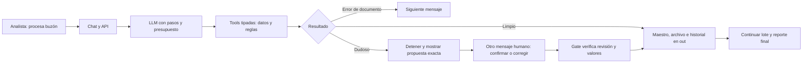
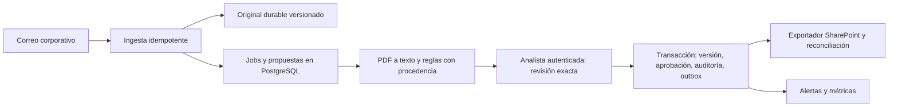

# Plan atómico vigente — Node + LangGraph + LangChain

Actualizado: 2026-11-04. Arquitectura autorizada: ADR-004. La migración está **PARCIAL**, en desarrollo y sin commit ni despliegue. Esta sincronización solo modifica documentación.

Fuente vigente: `/Users/jackaguilar/reto-periferia-ia-integracion/plan/PLAN-ATOMICO.md`. Checkout: `/Users/jackaguilar/reto-periferia-ia-integracion`; rama `codex/langgraph-reto`; HEAD `e7350944cfe5ee83d809fbc4fe90c54068122fae`. Referencia anterior: rama local `release/ai-sdk-referencia` en el mismo commit. El release entregado `release/entrega-2026-11-03` y su tag permanecen intactos. El checkout original conserva sus borradores y remite aquí.

## Estado vigente y prioridad inmediata

- **A1 CUMPLE:** extracción integrada en e735094; tsc limpio, 55/55 pruebas y demo ×2 exit 0 determinista en ese commit.
- **Migración PARCIAL:** proveedor LangChain de un paso y grafo LangGraph implementados como borradores. Última comprobación disponible del checkout conjunto: TypeScript limpio y **86/86 pruebas**; no se reejecutan por esta edición documental. No constituye aceptación de seguridad.
- **P0 abierto — A4:** una confirmación con identificador válido y texto de excepción/instrucciones adicionales puede autorizar un registro no inequívoco. La revisión reprodujo, entre otros, «confirmo revisión <UUID> pero espera mi segundo mensaje». Se requieren regresiones y nueva revisión del parser completo; los cambios parciales no cierran el hallazgo. La revisión adversarial terminó incompleta por límite de uso del agente.
- **Siguiente acción exacta:** cerrar A4-P0 en el motor LangGraph con aceptación cerrada de la decisión humana; comprobar la totalidad del mensaje y el snapshot. Texto ambiguo, exceptivo o condicionado solicita aclaración sin escribir. Después integrar A3–A8, conservar A2 pendiente y completar las puertas de A12.
- No publicar hasta resolver los P0 y verificar exactamente el contenido a publicar. No hay aprobación para tratar la migración como lista para datos reales.

## Decisión arquitectónica vigente

Node ejecuta TypeScript nativo; LangGraph gobierna nodos, estado, checkpoints, interrupt y Command; LangChain ChatAnthropic invoca el modelo una sola vez por paso y devuelve solicitudes de herramientas. Las herramientas y las reglas del PRD conservan sus contratos e independencia del motor. El backend decide la autorización contra operación, valores, revisión y huella de fuente/maestro; el LLM no autoriza.

Excepción explícita autorizada por el dueño a las dependencias de la primera entrega: `@langchain/langgraph` 1.6.1, `@langchain/core` 1.3.4, `@langchain/anthropic` 1.6.0 y `langsmith` 0.11.8; se conserva `zod` 4.6.7 y las dependencias dev fijadas en el manifiesto. No se amplía esta excepción a otras bibliotecas sin justificación. LangSmith permanece sin envío externo de trazas, incluso ante variables heredadas habilitadas.

MemorySaver solo demuestra continuidad dentro del proceso en A. B exige checkpointer durable, identidad, integridad transaccional, recuperación, restauración y reversión probadas. Rapidez, reducción de tokens y ahorro son **hipótesis pendientes de medición**, no ventajas demostradas de la migración.

ADR vigente: `/Users/jackaguilar/reto-periferia-ia-integracion/docs/adr/004-langgraph-orquestacion.md`.

## 1. Resultado esperado antes de dividir tareas

### Etapa A: entrega del reto

Una analista abre el chat y solicita procesar el buzón con `hoy=2026-09-03`. Ve cada intento de herramienta, su resultado y una tabla por mensaje. Se registran 001/002; 003 actualiza la fila y conserva el original y el historial; 004 es duplicado sin escritura de negocio; 005 se rechaza con motivo. El error de un documento permite pasar al siguiente; una revisión humana suspende el turno y pregunta explícitamente por sus campos y valores. 006 permanece sin registrar. Al recibir la confirmación del ejemplo del PRD en el siguiente mensaje, se registra exactamente el valor 0 y la fecha 2027-08-31 aprobados, se reanuda lo pendiente y se termina el reporte de alertas. El reporte final refleja también el registro de 006.

El LLM elige herramientas y conduce la conversación. Los valores y el resultado oficial se construyen con las herramientas; la aprobación procede de la entrada humana verificada por el backend. Un fallo del proveedor conserva sesión, acciones ya ejecutadas, revisión recuperable y consumo conocido. La demo directa sigue funcionando sin clave ni modelo, incluida su segunda llamada con `confirmado:true` como simulación explícita del humano (§6.6).

**Invariantes A:** fixtures inmutables; escrituras de datos solo en `out/`; cinco tools importables sin HTTP; `execute` siempre devuelve JSON y nunca lanza; no shell accesible al LLM; ausencias con confianza 0 salen como `null`; no valor ficticio por aprobar un campo ausente; argumentos zod estrictos; rechazo y ambigüedad no autorizan; cada intento tiene un único resultado visible y auditable; fallo no se convierte en éxito; consumo desconocido se distingue de cero; secretos fuera de respuestas/logs/entrega.

**Definición de terminado A:** HU-1–HU-6, RN1–RN7, CA1–CA5, §8 y entregables obligatorios §9 con matriz CUMPLE y evidencia sobre la versión exacta publicada. Demo ×2 exit 0 y datos iguales salvo timestamps; arranque limpio reproducible; chat integrado y un turno real del proveedor verificados con gasto acotado; URL y SHA desplegado comprobados. Bonus marcado por separado. Sin pendientes bloqueantes del PRD. Esto acredita una entrega demostrable, no operación productiva.

Se conservan las restricciones: Node con TS nativo, imports `.ts`, sin `any`, dependencias exactas con la excepción LangGraph/LangChain/LangSmith autorizada en este plan, CSV y carpetas; sin conectores reales, BD, OCR, roles ni reconstrucción histórica ejecutada. Memoria y archivos locales están permitidos. Reinicios, pérdida del disco y transacciones entre varios recursos no quedan garantizados en A: son límites explícitos, no supuestos ocultos.

### Etapa B: piloto operativo mínimo

Perfil derivado del PRD: **una organización**, analista administrativa dueña del proceso con suplente; gerencia consulta alertas; TI administra; comerciales envían al buzón y no necesitan chat. No se inventa un revisor adicional ni segregación de funciones obligatoria. No se deducen contratos/mes, concurrencia real, presupuesto aprobado ni SLO a partir de seis fixtures.

Antes de escribir datos reales: validar responsable y relevo, autoridad del maestro, tratamiento permitido de contratos y datos tributarios/personales, residencia/proveedor, retención, acceso al tenant, volumen pico y presupuesto. El perfil inicial de prueba será sintético o anonimizado; concurrencia de procesamiento 1 con cola durable y admisión limitada. Es una decisión conservadora de diseño, no una medición de capacidad ni de demanda.

Hipótesis operativas para negociar en B0: una analista activa y su relevo; jornada de oficina; recuperación del servicio en ≤4 horas y recuperación de datos en ≤24 horas para shadow sin efectos sobre el maestro; antes del modo asistido, bajar el objetivo de pérdida de operaciones aceptadas a ≤15 minutos, con originales recuperables y reconciliación. Estos números son propuestas de ensayo, no requisitos del PRD ni compromisos aprobados. Si la pérdida de operaciones confirmadas debe ser cero, se cambia el diseño de disponibilidad/replicación y su presupuesto antes del corte. Presupuesto: formular hosting + BD/backups + almacenamiento + identidad + LLM + operación; no contratar ni fijar USD ficticios.

Flujo B: recibir correo real → conservar original/versiones y procedencia → extraer texto de PDF nativo en entorno limitado → validar y generar propuesta durable → revisión humana autenticada → verificar identidad, valores, documento y versión vigente → transacción de registro y auditoría → exportación/archivo remoto con reintento y reconciliación → alertas y seguimiento por responsable. Escaneados, archivos ilegibles, firmas no verificables o formatos fuera del corpus van a cola manual; sin inferir validez jurídica ni inventar OCR.

**Definición de terminado B:** identidad y permisos probados; procesamiento e idempotencia sobreviven reinicios; cambios y aprobaciones exactas no se pierden ni duplican por reintentos; fallos entre BD y SharePoint quedan recuperables; backup restaurado en entorno separado dentro de objetivos aceptados; límites, alertas y responsable operativos; despliegue y reversión ensayados; corpus y evals representativos; shadow comparado con registro humano; paso a asistido aprobado con evidencia. Todo ello bajo un volumen y presupuesto medidos/aceptados en B0. Cero escrituras no autorizadas es condición de salida, no una garantía inferida de tests.

## 2. Diagnóstico histórico anterior a A1 y a la migración

Esta sección conserva la evidencia del diagnóstico inicial, sobre bb7f56b y sus borradores. Los resultados y afirmaciones de estado siguientes son históricos; el estado vigente está al inicio de este documento.

### Estado de Git y conservación

- `main` local y remoto consultado: `bb7f56b…`. Release congelado: `release/entrega-2026-11-03` en `0a5eaa6…`; el tag anotado `entrega-2026-11-03` se conserva. No se ha hecho commit, push ni reset.
- Modificados preexistentes: `.env.example`, `SOLUCION.md`, `src/domain/extraccion.ts`, `src/domain/reglas.ts`, `src/llm/adapter.ts`, `src/llm/anthropic.ts`, `src/tools/contratos.ts`, `web/index.html`.
- Sin seguimiento preexistentes: `.DS_Store`, `entrega/`, `plan/PLAN-ATOMICO.md`, `tests/agent/adapter.test.ts`, `tests/agent/front.test.ts`, `tests/core/prd-domain.test.ts`. No se deben agregar en bloque.
- `plan/CONTINUAR.md` y `plan/PROGRESO.md` están ignorados. Sus antiguos 38/38 o 47/47 y el HEAD `0a5eaa6` no describen el árbol actual. El borrador atómico cubre principalmente A; no constituía un plan productivo completo.

### Evidencia ejecutada

| Verificación | Resultado observado | Interpretación |
|---|---|---|
| Runtime local | Node `v26.7.0`, npm `11.19.0` | Docker usa `node:24-slim`; reproducibilidad entre entornos pendiente |
| `npx tsc --noEmit` (binario local, `--no-install`) | Exit 0 | Tipos pasan; comportamiento no queda acreditado |
| `node --test 'tests/**/*.test.ts'` | **64 pruebas: 47 pasan, 17 fallan** | El estado conjunto no es publicable |
| Pruebas focales del agente | 30/31 | Falla integración con tools reales; adapter 5/5 y front 5/5 aislados |
| Demo dos veces desde `out/` limpio, copia aislada y sin clave | Exit **1/1**; stdout igual; `out/` igual quitando `ts` | Es determinista, pero determinísticamente incorrecta |
| Fixtures originales antes/después de demo aislada | Hashes iguales | Inmutabilidad verificada en esa comprobación |
| `GET /api/health` público | HTTP 200, Anthropic, `claude-sonnet-5-5` | Disponibilidad básica; sin SHA, sin turno real del modelo |

Copias aisladas y salidas de demo: `/var/folders/hl/cqpm76c97kz568gc3fdv8ftc0000gn/T/reto-diagnostico-s23w804c/demo-1.txt` y `demo-2.txt` (temporales). No se limpió ni ejecutó la demo sobre el `out/` original.

### Tablero histórico del diagnóstico inicial

| Criterio | Estado | Evidencia y consecuencia |
|---|---|---|
| Arquitectura chat → backend → tools; prompt y conocimiento separados | CUMPLE en estructura | `src/agent/context.ts`; `src/server.ts:175`; pruebas de contexto pasan. No equivale a flujo completo correcto |
| HU-1 buzón y rechazo de cotización | CUMPLE | `src/tools/contratos.ts:105`; prueba de 6 mensajes pasa; 005 rechazado en demo |
| HU-2 extracción y ausencias | PARCIAL | `src/domain/extraccion.ts:87`, `src/tools/contratos.ts:138`; regex trata NIT/RUC como monedas. HU-2c y fixtures válidos fallan |
| HU-3 / RN1–RN4 | PARCIAL | `src/domain/reglas.ts:42`; dos tests RN1/RN2 pasan; flujo real no clasifica cinco contratos por extracción rota |
| HU-4 registro, archivo e historial | PARCIAL | `src/tools/contratos.ts:282`; integración falla en `tests/agent/integracion.test.ts:42`; gate vulnerable y sin garantía de escritura multiartefacto |
| HU-5 alertas | PARCIAL | `src/domain/alertas.ts:22`; demo genera reporte, pero faltan los nuevos registros. Solo hay estado de póliza; no fuente de fecha de vencimiento de pólizas |
| HU-6 error recuperable por documento | NO CUMPLE | `tests/core/prd-domain.test.ts:48`; caso válido siguiente también falla por NIT/RUC |
| RN5 y CA3 revisión humana | NO CUMPLE | `src/agent/run.ts:63`, `:67`, `:170`, `:218`, `:226`, `:232`; bypass y ausencia de suspensión reproducidos |
| RN6 fixtures solo lectura | CUMPLE en comprobación actual | `src/infra/maestro.ts:12`; prueba de seguridad/hash y demo aislada |
| RN7/CA4 auditoría completa | NO CUMPLE | `src/agent/registry.ts:33`; `src/agent/run.ts:170`, `:181`, `:199`; se omiten vetos, inválidos y sonda visible |
| CA1 pasos y límites configurables | PARCIAL | `src/agent/run.ts:6`, `:179`, `:226`; cuenta llamadas, mantiene 25 fijo, no lee MAX_STEPS |
| CA2 valores de tools | PARCIAL | `agent/prompt.md:15`; reextracción del backend protege parte del flujo, pero override puede cambiar 0 aprobado por 999; narración libre no verificada |
| CA5 fallo del proveedor y continuidad | PARCIAL | `src/server.ts:207`; error seguro, pero pierde sesión recuperable en primera respuesta fallida y resultados parciales |
| Front errores y render de texto | CUMPLE aislado / PARCIAL integrado | `web/index.html:455`; 5/5. Espera campos parciales que backend aún no devuelve |
| §8 costo y timeout | PARCIAL | `src/llm/anthropic.ts:8`, `:31`; timeout probado. Consumo parcial se pierde y límite diario tiene carrera entre sesiones |
| §8 seguridad | PARCIAL | Tests de clave en respuestas, traversal y cabeceras pasan. No se realizó nueva auditoría completa de secretos de todo el historial ni autorización multiusuario |
| §8 arranque <2 minutos | PARCIAL, no medido ahora | `package.json`, `Dockerfile:1`; no hubo instalación limpia ni build Docker en este diagnóstico |
| §9 documentación/costo | PARCIAL | SOLUCION tiene 11 secciones y estimación, pero HU “Hecho” y referencias a pruebas verdes contradicen este árbol |
| §9.3 link | PARCIAL | Health 200; falta SHA desplegado y prueba de conversación real actual |
| §9.4 bonus módulo | CUMPLE pruebas existentes / validación final pendiente | `tests/core/modulo.test.ts:13`, `:19`, `:25`; reexporta las mismas tools, no requiere servidor; documentación exige copiar también `src/` |
| Preparación productiva B | NO CUMPLE | `src/agent/session.ts:38`, `src/infra/registros.ts:19`, `src/tools/contratos.ts:252`, `:278`, `:319`; memoria, disco efímero, sin identidad ni transacción global |

### Reproducciones adversariales adicionales

Ejecutadas por el agente de ciclo con el SDK instalado y `fetch` simulado, o funciones puras/tools falsas para contar escrituras. Sin proveedor real, sin datos productivos y sin modificar fuentes:

1. Un paso con validar 006 y alertas ejecuta validar, sonda registrar y alertas; hace otra petición al modelo y acepta “terminado sin pregunta”. Serializar tools no basta para suspender CA3.
2. `extraer({})` es rechazado antes de `execute`; queda sin llamadas visibles. El log dentro de execute no cubre CA4.
3. Una tool completada seguida de HTTP 400 del proveedor deja únicamente mensaje user y tokens 0 en sesión.
4. Revisión creada + fallo LLM: `session.pending=null`, pero WeakMap conserva pendiente; siguiente “ok” con `confirmado:true` permite la escritura simulada aunque la revisión nunca se expuso.
5. `confirmo msg-0060` casa con msg-006; confirmar valor 0 permite al modelo override 999 porque solo se restringen nombres de campos.
6. Presupuesto diario 100, dos sesiones concurrentes de 80: ambas HTTP 200, uso 160; tercera 429. Comprobar saldo antes y sumar después no reserva capacidad.

No todas estas reproducciones quedaron como pruebas versionadas: A incorpora regresiones persistentes antes de considerar resueltos los hallazgos.

## 3. Decisiones arquitectónicas y patrones DevTalles

No se dispone aquí de las fuentes completas del curso. Se evalúan los patrones identificados en ADR-001 y notas locales, sin atribuir al curso detalles no inspeccionados. Las APIs se contrastaron con los tipos instalados y documentación oficial.

| Patrón | Decisión A / B | Riesgo que resuelve y prueba |
|---|---|---|
| Tool use y esquemas zod | Conservar | Superficie pequeña; argumentos inválidos/desconocidos se devuelven y auditan sin ejecutar |
| ReAct acotado de un solo agente | Conservar | El flujo depende del resultado anterior; pasos, tiempo, tokens y coste acotados. Test con varias tools en un paso |
| Juez programático RN1–RN5 | Conservar y endurecer | El LLM no decide clasificación ni valor final. Fixtures, conflictos, repeticiones y errores de contenido |
| HITL con interrupt/Command y autorización propia | LangGraph suspende; el backend valida la decisión exacta. Durable/autenticado en B | A4-P0 abierto: ID válido no autoriza texto ambiguo; probar contenido íntegro, valores, fuente, maestro, caducidad y replay |
| `toolApproval` de AI SDK | Alternativa histórica sustituida por ADR-004 | No implementarlo en el motor vigente; los interrupts del grafo tampoco sustituyen identidad, autorización o persistencia durable |
| Paralelismo de herramientas | Serializar ejecución de efectos en A; controlar leases/transacciones en B | Evitar escritura iniciada después de detectar revisión. Test de varias llamadas del mismo paso y diferentes sesiones |
| Plan-and-Execute, router LLM, CodeAct, agentes de aplicación múltiples | No introducir | No mejoran criterios actuales; shell/generated code amplían riesgos. RN clasifica sin LLM. Los subagentes de desarrollo son otra cosa |
| Conocimiento completo en prompt | Conservar mientras sea pequeño | Evita infraestructura RAG innecesaria. Añadir recuperación solo por tamaño/calidad medidos |
| Cascada Haiku/Sonnet, caching, resumen de historial | Experimentos posteriores, sin activación automática | Escalar o resumir puede alterar HITL y coste. Requiere evals comparables, entrada/salida/cache medidas y conservación de estado autoritativo |

La integración vigente contrasta los tipos instalados de LangGraph y LangChain con ADR-004. `generarPaso` devuelve texto, solicitudes de herramientas y consumo conocido/desconocido; el grafo ejecuta y audita cada intento, incluidos los malformados. Las APIs de AI SDK inspeccionadas durante el diagnóstico quedan como referencia histórica en la copia anterior archivada, no como instrucciones de implementación.

### Arquitectura mínima propuesta para B

Conservar el monolito Node, el dominio determinista y el grafo LangGraph. Sustituir MemorySaver por un checkpointer durable respaldado por PostgreSQL, y añadir PostgreSQL gestionado para estado del flujo, idempotencia, sesiones, revisiones, auditoría y reservas de uso; identidad corporativa del mismo tenant; biblioteca SharePoint versionada para originales/archivo y exportación. Un procesador de cola de baja concurrencia puede ejecutarse junto al servicio, con jobs en PostgreSQL; no se necesita un broker ni microservicios. El parser PDF trabaja con tiempo/tamaño/memoria limitados en proceso aislado.

Se propone PostgreSQL como autoridad de contratos **solo si** B0 acuerda que Excel deja de editarse como maestro. Entonces CSV/Excel son proyecciones/exportaciones y cada escritura genera outbox en la misma transacción. Si Excel debe seguir siendo autoridad, PostgreSQL conserva el flujo y las propuestas; el piloto permanece en shadow hasta diseñar y probar un único escritor controlado y reconciliación con versiones de Excel/SharePoint. No habrá dos maestros editables ni un corte silencioso.

PostgreSQL añade garantías transaccionales, pero sus niveles de aislamiento no sustituyen restricciones únicas, versiones y reintentos de serialización: [documentación oficial](https://www.postgresql.org/docs/current/transaction-iso.html). Los archivos remotos quedan fuera de esa transacción; la outbox y la reconciliación cubren esa frontera. Se busca un único efecto de negocio comprobable con entregas al menos una vez, no prometer transporte “exactamente una vez”.

Ampliaciones justificadas respecto de A: driver PostgreSQL y migraciones; validación OIDC; parser PDF nativo; llamadas Graph; almacenamiento durable y backups. Sus librerías/versiones, permisos y coste se fijan en B1 tras revisar APIs y vulnerabilidades vigentes. Las dependencias de infraestructura B se justifican por separado; no forman parte de la excepción de frameworks ya autorizada para A.

## 4. Plan atómico A

Prioridades: P0 bloquea la entrega correcta/segura; P1 cierra demostración, documentación y reproducción. Cada unidad incluye revisión independiente, matriz de su criterio y puertas globales. Las rutas de pruebas nuevas son propuestas. Rutas compartidas se trabajan secuencialmente, nunca por dos autores a la vez.

Modelos de desarrollo: **Luna = gpt-6-luna**, **Sol = gpt-6.1-sol**, **Astra = gpt-6-astra**. Son distintos del LLM de la aplicación (default local Haiku 5.5; health público hoy declara Sonnet 5.5). El coordinador integra y es el único que realiza commits/push.

| ID / resultado coherente | Criterio y etapa/prioridad | Depende de | Archivos e interfaces responsables | Agente / modelo / esfuerzo | Prueba de aceptación |
|---|---|---|---|---|---|
| A0. Base, ownership y selección de borradores | PRD completo; A/P0. Diagnóstico completado, preparación ejecutiva pendiente | Habilitación de ejecución para mutar | Coordinador: `plan/PLAN-ATOMICO.md`, `CONTINUAR.md`, `PROGRESO.md`; integración aislada desde HEAD | Coordinador/Sol alto | Inventario de hunks por unidad; release intacto; reproducir 47/64 y fallos demo; ningún borrador perdido; tests del árbol que se va a publicar separados de cambios ajenos |
| A1. Extracción fiel y errores recuperables | HU-2c, HU-6, §7.2; A/P0 | A0 | Dominio: `src/domain/extraccion.ts`, cambios pertinentes de `src/tools/contratos.ts`; `tests/core/extraccion-prd.test.ts` y hunks de tests existentes | Trabajador dominio/Sol alto | NIT/RUC no son monedas; EUR explícita en cláusula monetaria sí falla; texto vacío/fecha imposible → ok:false; siguiente mensaje válido funciona; ausencias null, objeto sin prefijo antes de truncar; seis fixtures según PRD |
| A2. Clasificación sin actualización o inserción espuria | HU-3, RN1–RN4, O2; A/P0 | A1 y decisiones RN abajo | Dominio: `src/domain/reglas.ts`, `tests/core/reglas-prd.test.ts` | Trabajador dominio/Sol alto | Matriz id/valor/fechas, otrosí con y sin cambios, NIT+objeto≥0.9, id distinto y póliza; repetición sin fila/historial extra; conflicto de identidad a revisión |
| A3. Proveedor LangChain de un paso — PARCIAL | CA1/CA4 y §8; A/P0 | A1; ADR-004 | `src/llm/{adapter,anthropic}.ts`, `.env.example`, `tests/agent/langchain-provider.test.ts`; generarPaso y mensajes/callID/uso | Trabajador proveedor/Sol medio; coordinador integra | ChatAnthropic real con HTTP simulado valida schemas e historial; proveedor no ejecuta herramientas; malformados conservan intento y tokens; timeout/cancelación, output acotado, sin reintentos ocultos; tracing externo desactivado incluso con env heredado |
| A4. Grafo y aprobación exacta — PARCIAL, P0 abierto | CA2/CA3, HU-4, RN5; A/P0 | A3; cierre de conflictos de dominio A2 antes de A12 | `src/agent/{graph,run,session}.ts`, `src/server.ts`, `web/index.html`, tests LangGraph y de confirmación | Trabajador grafo/Sol alto; otro agente revisa HITL; coordinador integra | Nodos separados modelo/herramienta/revisión/interrupt/registro; revisión suspende antes del siguiente efecto. Reanudación Command tras validar decisión completa del humano y snapshot. ID válido con «pero espera», «excepto el valor» o modificación en palabras no autoriza. Probar 0060, negación, misma vuelta, respuesta perdida, fuente/maestro cambiados y replay; ejemplo PRD y demo directa siguen funcionando |
| A5. Auditoría del grafo y checkpoint — PARCIAL | CA4, RN7; A/P0 | A3,A4 | `src/agent/{graph,registry}.ts`, wrapper `src/tools/contratos.ts`, `src/infra/registros.ts`, tests de auditoría/grafo | Trabajador grafo/Sol alto | Cada intento del modelo y sonda/veto/inválido/desconocido/cancelado tiene una entrada final visible y un log; callID correlacionable, sin duplicar execute; checkpoint conserva cola e historial modelo/tool ordenado; no fuga de claves o contenido privado |
| A6. Resultado parcial y recuperación del turno — PARCIAL | CA5/CA4, HU-6; A/P0 | A4,A5 | `src/agent/{graph,session}.ts`, `src/server.ts`, `web/index.html`, tests API LangGraph y error parcial | Trabajador HTTP/Sol alto | ErrorTurnoGrafo.partial conserva sessionId, llamadas, revisión y uso conocido; GET recupera historial. Pendiente: cliente obtiene/persiste sesión antes del primer efecto y usa requestId para no repetir un POST perdido antes del primer byte. Reintento de un nodo no repite escritura; MemorySaver se limita a A, reinicios se prueban con B2/B6 |
| A7. Presentación de hechos y revisión — PARCIAL | CA2/CA5, §6.1/§11; A/P0 | A6 | `web/index.html`, salida oficial en `src/agent/graph.ts`, tests front y API | Trabajador UI/Sol medio | Resumen y prosa de hechos contractuales se derivan de tools; ninguna respuesta ni historial rehidratado afirma 999 inventado. Botón aprueba revisión exacta, panel y errores únicos legibles; restore conserva estado sin reenviar aprobación a otra sesión; datos como texto |
| A8. Presupuestos del grafo y admisión concurrente — PARCIAL | §8 costo/robustez, CA1; A/P0 | A3,A6 | `src/agent/graph.ts`, `src/server.ts`, opciones proveedor, `.env.example`, tests de presupuesto | Trabajador límites/Sol alto | MAX_STEPS cuenta llamadas modelo, MAX_TOOL_CALLS separa herramientas; timeout/output/tokens por sesión acotados. Pendiente: reservar presupuesto antes de admitir llamadas concurrentes, reconciliar uso y retener reserva desconocida; usage.known=false no equivale a cero medido. En B las reservas sobreviven reinicios |
| A9. Arranque, entorno y módulo reproducibles | §8 arranque/determinismo,§9.4; A/P1 | A1–A8 | Entorno: `Dockerfile`, manifiestos solo si necesario, scripts de verificación; `scripts/build-modulo.ts`, `modulo/**`, `tests/core/modulo.test.ts` | Trabajador entorno/Sol medio; documentación Luna medio | npm ci en copia limpia y runtime declarado; front+backend con un comando, medir <2 min; image/runtime fijados de forma reproducible; tools del módulo idénticas/importables y flujo sin HTTP; no .env/node_modules/out en entrega |
| A10. Diagnóstico por turno y versión desplegable | §8 y verificación operativa; A/P1 | A6,A8 | HTTP: `src/server.ts`, logger específico y `tests/agent/observabilidad.test.ts`; BUILD_SHA/API health | Trabajador HTTP/Sol medio | Un resumen seguro por turno, también en error, con correlación/modelo/latencia/steps/tokens conocidos; sin prompt ni contrato; health incluye SHA/config segura; uso desconocido no aparece como 0; se distingue revisión, error tool y fallo proveedor |
| A11. Documentación fiel y gobierno completo | §7.5,§9.1/9.2; A/P1 | Evidencia A1–A10 | Docs: `SOLUCION.md`, `README.md`, `docs/{PRODUCTO,RUNBOOK}.md`, ADRs y estado local por coordinador | Trabajador docs/Luna alto; coordinador valida | 11 secciones, estados sustentados, costes fechados con supuestos y desglose no inventado; regla de gobierno con relevo/acuse/escalamiento/campaña/indicador; límites A/B explícitos; uso real de IA, sin atribución en commits |
| A12. Auditoría y entrega del contenido exacto | Todo PRD obligatorio; A/P0 | A1–A11 | QA/coordinador: `tests/agent/integracion.test.ts`, regresiones adversariales/evals offline, matriz de evidencia y empaquetado; no editar release congelado | QA distinto de autores/Sol alto; Astra revisa HITL/datos | Suite completa, demo×2 y fixtures; SDK real simulado por API+UI con lote, revisión, confirmación, reporte, fallo y reintento. Luego prueba real acotada, SHA+health y turnos del despliegue; ZIP inspeccionado; sin NO CUMPLE obligatorio ni secretos |

**Decisiones RN1/RN2 que implementará A2:** mantener prioridad de RN1 para reenvío con id/valor/fechas iguales, declarando que metadatos solos no convierten ese reenvío en actualización; un otrosí repetido sin diferencias no produce historial vacío. Evaluar identidad (cliente/NIT/objeto incompatible) antes de sobrescribir por id; conflicto no es vía rápida de actualización. Coincidencia NIT+objeto con id diferente y sin cambio sustantivo se tratará como probable duplicado con revisión de identidad, sin insertar automáticamente otra fila. Esta última interpretación corrige el riesgo de duplicación del borrador, y se registra como supuesto por ambigüedad del PRD. La ausencia de evidencia nueva de póliza no debe degradar una vigente a pendiente; cambio de estado exige fuente explícita. Si el PRD admite varias lecturas, conservar ejemplos y justificar el comportamiento elegido, sin presentar SPEC como requisito superior al PRD.

**Aprobación A:** la UI presenta revisión con identificador opaco y snapshot emitidos por backend y los devuelve junto a la decisión de la persona. El chat mantiene compatibilidad con el texto del PRD normalizándolo contra esa revisión única ya expuesta/recuperada; campos o valores no expresamente aprobados no se derivan de propuestas del modelo. Si se corrigen valores, se valida y se muestra el nuevo snapshot antes de escribir cuando la intención no es inequívoca. Un POST perdido, revisión no mostrada o sesión expirada conduce a recuperar/revisar, no a autorizar por “ok”. No se introducen cuentas de usuario en A: es una capacidad de sesión para la demo; la identidad durable llega en B.

**Límite del almacenamiento A:** archivo, historial, maestro y procesados se escriben en operaciones separadas (`contratos.ts:252–278,319–320`). A12 probará repetición después de registro completado y error de proveedor, y fallos de E/S se informarán sin éxito ficticio ni reintento automático ciego. No afirmar atomicidad de varios archivos por usar rename. Recuperación robusta ante crash/pérdida de disco es criterio B; si una prueba de A muestra corrupción en el flujo obligatorio, se abre corrección acotada antes de cerrar A.

## 5. Plan atómico B

Estas unidades son un plan condicionado al perfil y a la habilitación de ejecución B. No bloquean la entrega A, no justifican ampliar el reto ni habilitan por sí mismas datos reales. B0 y B1 concretan los parámetros sin inventarlos.

| ID / resultado coherente | Requisito y etapa/prioridad | Depende de | Archivos e interfaces responsables propuestos | Agente / modelo / esfuerzo | Prueba de aceptación |
|---|---|---|---|---|---|
| B0. Contrato operativo y proceso responsable | Perfil, presupuesto, privacidad, SLO y gobierno; B/P0 | A cerrado; acceso a responsables para validar | Coordinador: `docs/piloto/PERFIL.md`, `GOBIERNO.md`; ninguna configuración productiva aún | Coordinador/Sol alto; negocio valida | Dueña y relevo, autoridad Excel/BD, corpus, volumen pico observado, límites, presupuesto, residencia/retención, RPO/RTO y criterios de salida firmados. Sin definición suficiente, solo shadow sintético/anonimizado |
| B1. Puertos y autoridad de datos acordados | Integración mínima y ampliaciones justificadas; B/P0 | B0 | Arquitectura: ADR piloto; `src/application/ports.ts`, contratos de repositorio/documento/identidad y aprobación durable consumible; `src/tools/contratos.ts` solo para conectar puertos manteniendo adapter A | Trabajador arquitectura/Sol alto; Astra adversarial | Demo A idéntica; un único maestro editable; esquema de estados, claves y transacciones documentado, incluido ApprovalRepository.consume con actor/snapshot/versiones/expiración; driver/OIDC/parser/Graph justificados; ninguna promesa de atomicidad remota |
| B2. Estado y sesiones durables | Persistencia, aislamiento de organización, migraciones; B/P0 | B1 | Persistencia: `src/infra/postgres/**`, `migrations/**`, pruebas de repositorio; checkpointer durable LangGraph y tablas de jobs/sesiones/revisiones/uso/audit y versiones contrato | Trabajador datos/Sol alto | Reiniciar conserva checkpoints, cola, sesiones y pendientes; esquema mínimo de aprobación durable y constraints tenant/origen/mensaje/versión; migración desde cero y validación de datos; los fixtures A siguen inmutables |
| B3. Identidad y autorización por operación | AuthN/AuthZ; B/P0 | B1,B2 | Identidad: `src/auth/**`, middleware/API de sesiones en `server.ts`, UI login; pruebas autorización | Trabajador seguridad/Sol alto; Astra revisa | Analista y relevo confirman lo autorizado; gerencia solo lee; TI opera sin aprobación de negocio implícita; otro usuario/tenant no accede por conocer sessionId; expiración/CSRF/audiencia/emisor; reset de demo deshabilitado en piloto |
| B4. PDF nativo con procedencia y salida manual | Corpus real, extracción segura, datos verificables; B/P0 | B0,B1 | Documentos: `src/ingestion/pdf.ts`, modelo de evidencia página/cita/hash, límites del parser; `tests/piloto/pdf/**` con corpus permitido | Trabajador documentos/Sol alto | PDF con texto de varias plantillas permite rastrear cada campo; ilegible/escaneado/encriptado/malformado/sobredimensionado no se inventa ni bloquea cola; límites tiempo/memoria; sin revisión jurídica automática ni OCR implícito |
| B5. Ingesta Graph y originales durables | Recepción, identidad fuente e idempotencia de ingesta; B/P0 | B2,B3,B4 | Conector entrada: `src/infra/graph/inbox.ts`, `documents.ts`, checkpoint durable y pruebas de contrato | Trabajador conectores/Sol alto | Entrega duplicada/movimiento de correo/reinicio entre páginas no pierden ni duplican trabajo; checkpoint avanza tras persistir; originales versionados con hash verificable y permisos mínimos; adjunto nuevo crea versión, no reutiliza aprobación |
| B6. Máquina de estados y recuperación de jobs | Reintentos, reinicios y concurrencia; B/P0 | B2,B4,B5 | Orquestación: grafo LangGraph con checkpoint durable, `src/application/jobs/**`, leases/retry/scheduler; pruebas de caída | Trabajador flujo/Sol alto | Estados recibido/propuesto/revisión/aprobado/registrado/exportación/fallo en el mismo flujo; no crear otro bucle de agente paralelo; lease con fencing impide worker obsoleto; reiniciar en cada frontera no pierde caso; backoff acotado; fallo permanente a cola manual; no repetir side effect de resultado indeterminado sin reconciliar |
| B7. Registro transaccional y outbox | Integridad, idempotencia de operación y concurrencia; B/P0 | B1,B2,B3,B6 | Servicio registro: `src/application/registrar.ts`, repositorio contratos/historial/outbox y consumo de aprobación del contrato B1/B2 | Trabajador datos/Sol muy alto; Astra revisa | Contrato/versión/historial/consumo de aprobación mínima/outbox se confirman juntos; consumo único concurrente se prueba aquí; misma idempotencyKey devuelve mismo resultado; otro otrosí es otra operación; conflicto optimista no sobrescribe. Endpoint de escritura no habilitado hasta B8. Publicación PG→SharePoint condicionada a autoridad PG aceptada |
| B8. Aprobación durable vinculada a actor y valores | HITL, autorización y prevención TOCTOU; B/P0 | B3,B6,B7 | Seguridad del flujo: `src/application/reviews/**`, endpoints decisión, UI revisión; usa esquema/consumo durable B1/B2/B7 | Trabajador seguridad/Sol muy alto; Astra adversarial | Actor autorizado aprueba operación/document hash/versiones/valores exactos/destino; expiración o cambio invalida; consume una vez mediante transacción ya implementada en B7; replay o LLM fabricando flags no escribe; reload y revisión simultánea recuperan decisión correcta |
| B9. Exportación/archivo SharePoint reconciliables | Side effects remotos, una sola autoridad; B/P0 | B5,B7,B8 | Conector salida: `src/infra/graph/sharepoint.ts`, consumidor outbox, reconciliador; pruebas por inyección de fallos | Trabajador conectores/Sol alto | Caída tras upload antes del ack y tras commit SQL antes de upload no duplica; verifica hash/ID/version/eTag, conserva original y otrosí; lista de huérfanos/conflictos resoluble; nunca éxito si exportación está pendiente; Excel no recibe edición paralela no controlada |
| B10. Secretos, acceso a documentos y ciclo de datos | Confidencialidad, aislamiento y retención; B/P0 | B3,B5,B9 | Seguridad operativa: configuración de secretos/referencias, filtros de log, descarga autorizada, tareas de retención, política backups | Trabajador seguridad/Sol alto | Rotación sin volcar secretos; permisos Graph/BD mínimos probados; URLs/cookies no filtran acceso; borrado/retención ejecutados sobre dataset de prueba según política; backup conserva o expira datos de forma explícita; datos de tenant inaccesibles al otro |
| B11. Reservas durables, métricas y alertas accionables | Consumo, límites, observabilidad; B/P0 | B2,B6,B8 | Operación: ledger uso en PG, instrumentación jobs/API/LLM, alertas y panel mínimo | Trabajador operación/Sol alto | Presupuesto persiste tras reinicios y concurrencia; salida/latencia/cola limitadas; timeout desconocido no libera todo; alertas por cola atascada, exportación fallida, gasto, autenticación y backups llegan al responsable de prueba y tienen runbook; sin contratos en telemetría |
| B12. Copias y restauración demostradas | RPO/RTO e integridad de recuperación; B/P0 | B2,B5,B9,B10,B11 | Operación: `ops/backup/**`, `ops/restore/**`, `docs/piloto/RESTORE.md`; evidencia de ensayo | Trabajador operación/Sol alto; QA independiente | Restaurar BD+originales/versiones en entorno aparte, medir RPO/RTO B0, verificar hashes y reconciliar outbox/reviews; aprobación antigua no se reejecuta; backup inaccesible a usuarios normales; “backup creado” sin restore no cumple |
| B13. Despliegue, migraciones y reversión ensayados | Reproducción, release y recuperación; B/P0 | B2,B3,B6–B12 | Entorno/CI: pipeline, imagen fijada, configuración por ambiente, migraciones compatibles, runbook rollback | Trabajador entorno/Sol alto; coordinador publica | Staging desde cero; versiones app/schema compatibles; migración interrumpida y rollback de código sin pérdida de datos; readiness incluye dependencias; diferencia liveness/readiness; smoke firmado con SHA y permisos; reversión no reactiva operaciones ya consumidas |
| B14. Evals y shadow con comparación humana | Calidad, cobertura y transición gradual; B/P0 | B4–B13; corpus permitido | QA/modelo: `evals/**`, golden set versionado y anonimizaciones, informes de shadow, política modelo/prompt | Trabajador QA/Sol alto; negocio valida | Mide campos correctos/falsos limpios, extracción fallida, decisiones de gate, latencia, coste y tiempo humano; holdout y casos adversariales; ninguna escritura al maestro en shadow; compara con registro real y cruce con facturación. Seis fixtures no acreditan precisión ni ROI |
| B15. Operación asistida acotada y decisión de continuidad | Gobierno y preparación operativa; B/P0 | B0,B8–B14 | Coordinador + dueña/TI: acta de habilitación, cohortes/límites, tablero y runbooks | Coordinador/Sol alto; Astra revisión final | Todas las escrituras asistidas requieren aprobación exacta; responsable y relevo atienden alertas; periodo y volumen acordados cumplen umbrales B0 sin incidentes abiertos de integridad; kill switch y reversión probados. Si Excel conserva autoridad, bloqueada hasta probar su único escritor/versionado/reconciliación; pruebas PG→export no acreditan ese camino. Sin autonomía por defecto |

**Condición de integración B:** cada unidad se integra en staging o shadow con escrituras al maestro deshabilitadas hasta reunir sus dependencias. B7 y B9 describen el camino con autoridad PostgreSQL; si B0 conserva Excel como autoridad, se redacta una unidad específica de escritor Excel con control de versiones y reconciliación antes de habilitar B15. No se considera cubierta por una exportación CSV ni se implementan ambos caminos especulativamente.

**Gobierno específico B:** el comercial envía contrato firmado, otrosí y actas; acuse de recepción distingue recibido de registrado, y no envía mensajes externos hasta tener destinatarios/contenido/autorización acordados. Excepciones y firmas ilegibles se escalan a la dueña y luego al responsable comercial, sin fingir revisión jurídica. El estado de póliza necesita responsable y evidencia nueva. La campaña junio–agosto y el cruce mensual con facturación se diseñan en A; B los ejecutaría solo tras autorización y acceso al universo de comparación. Contar correos procesados no mide contratos que nunca llegaron.

**Autonomía, OCR, RAG y cascadas** quedan fuera de la habilitación B inicial. Un experimento posterior tiene ID propio, hipótesis, coste acotado y evals; no cambia producción automáticamente. Render Free no sostiene las garantías propuestas: su documentación lo presenta para pruebas y describe límites de estado/operación. [Render Free](https://render.com/docs/free).

Para Graph se deberá usar una identidad estable del mensaje y su versión; los IDs Outlook ordinarios pueden cambiar al mover el correo. El identificador inmutable tiene límites documentados y no sustituye hash/versionado ni la deduplicación de negocio. [Microsoft Graph: identificadores inmutables](https://learn.microsoft.com/en-us/graph/outlook-immutable-id).

## 6. Conexión de unidades y delegación

A0 → A1 recupera los datos → A2 fija clasificación → A3 ofrece un proveedor LangChain de un paso → A4 gobierna el grafo y asegura decisión humana → A5 conserva toda evidencia → A6 expone fallo parcial → A7 presenta hechos y continuidad → A8 acota consumo → A9/A10 hacen reproducible e identificable la versión → A11 documenta evidencia → A12 verifica el producto conjunto y entrega. A3 se puede preparar en paralelo con A1/A2; análisis UI/docs también, pero no editar sus contratos hasta que se estabilicen. Ningún pase aislado de adapter/front sustituye A12.

B0/B1 fijan entorno y autoridad → B2/B3 estado e identidad → B4/B5 datos reales trazables → B6 ejecución recuperable → B7/B8 registro y aprobación transaccionales → B9 efectos remotos reconciliados → B10/B11 controles de operación → B12/B13 restauración y release → B14 evidencia de shadow → B15 operación asistida. El modo shadow permite avanzar calidad sin escribir el maestro; no exime privacidad, identidad, almacenamiento ni costes.

La primera ejecución de migración usó dos trabajadores con rutas exclusivas: proveedor (A3) y grafo (A4/A5). A1 ya está integrada; A2 permanece pendiente. Reutilizar agentes útiles y ajustar paralelismo al consumo disponible, sin relanzar investigaciones cerradas. Al cerrar sus unidades, reutilizarlos para ciclo y UI/entorno; reservar Astra para revisión adversarial de HITL/integridad/arquitectura. No multiplicar agentes por tarea pequeña. Luna se usa en inventarios y docs acotados; si falla aceptación o la decisión es ambigua, escalar a Sol. El coordinador integra, actualiza estado, crea commits y publica. Cada autor recibe: objetivo, criterio, rutas exclusivas, interfaz esperada, dependencias, restricciones y prueba de hecho, sin copiar el historial.

Investigadores usados en este diagnóstico: `diagnostico_dominio` (Luna, alto), `diagnostico_ciclo` (Sol, alto), `revision_plan` (Astra, alto). Todos fueron de solo lectura. La revisión del plan añadió PDF nativo/procedencia, autoridad única del maestro, revisión nunca expuesta, fallos entre escritura local/remota y cobertura contra facturación.

## 7. Puertas de revisión y publicación

Antes de **cada commit y cada push**, el coordinador verifica el árbol exacto que se publicará, sin depender de arreglos no incluidos:

1. Otro agente intenta refutar el cambio; cada criterio responde CUMPLE/PARCIAL/NO CUMPLE con archivo:línea y test.
2. `npx tsc --noEmit`.
3. `node --test 'tests/**/*.test.ts'`.
4. `node demo.ts` dos veces, cada vez desde `out/` limpio; comparar stdout y todos los artefactos, normalizando solo timestamps.
5. Fixtures intactos por diff y hashes; diff y paquete sin secretos, `.env`, node_modules, out o artefactos ajenos.
6. Commit atómico convencional, sin atribución a asistentes; sin tocar tag/rama congelados. Las ramas de preparación llevan prefijo `codex/`; main se actualiza solo con unidades verificadas.

El paquete de A1 no se valida usando accidentalmente cambios futuros A2/A3. Separar las pruebas combinadas del borrador en unidades coherentes al preparar integración, conservando su contenido. Nunca resolver esto descartando el trabajo original o agregando todo el árbol.

Después de push: comprobar SHA de la aplicación desplegada, `/api/health`, acceso previsto y prueba acotada del chat con revisión/aprobación. Health sin SHA o sin una conversación no cierra la entrega. Si no hay acceso de lectura a logs/despliegue, marcar la evidencia faltante explícitamente. No hay herramienta Render disponible en este entorno; no se pidieron ni imprimieron credenciales.

La revisión de secretos actual fue limitada a rutas/test inspeccionados: la afirmación histórica “sin secretos en historial/ZIP” debe repetirse sobre el contenido final; no se hereda como hecho actual.

## 8. Instantánea histórica de cuota/contexto y límites de memoria

Las cifras de cuenta y configuración siguientes corresponden al diagnóstico inicial, no a una consulta actual. El usuario cambió de modelo posteriormente; no inferir cuota, contexto o capacidad actuales de estos números.

- **Cuota de cuenta Codex:** herramienta read-only consultada: 42% usado en ventana de 300 minutos y 88% en ventana de 10.080 minutos, en el instante de consulta. Es compartida por la cuenta, no presupuesto de este proyecto ni de cada agente. No se activó ningún reinicio/crédito. No se puede deducir capacidad restante para una tarea concreta.
- **Indicador 78%:** no se observó su etiqueta ni origen; no se interpreta como cuota ni contexto. La consulta anterior no demuestra qué significaba.
- **Contexto de este chat:** cliente local `codex-cli 0.166.0-alpha.5.1`; configuración selecciona `gpt-6.1-sol`/`ultra`. Metadatos de esta sesión informan ventana efectiva 475.000; el catálogo local declara 500.000 con factor efectivo 95%. No se publica un porcentaje de contexto a partir de tokens acumulados ni se confunde con cuota. La instantánea de una llamada registró 63.458 tokens de entrada; no es una lectura continua de espacio restante.
- **Compactación del cliente:** la documentación oficial expone `model_auto_compact_token_limit`; si no está fijado usa defaults del modelo. Esa clave y `model_context_window` no están fijadas en el config local inspeccionado. El harness de esta sesión declara compactación automática disponible; no se observó aún un evento de compactación ni un umbral efectivo. Por tanto: capacidad disponible, activación puntual/umbral no comprobados por evento. [OpenAI Docs: configuración](https://learn.chatgpt.com/docs/config-file/config-reference).
- **Ajuste propuesto durante planificación:** mantener defaults; no ampliar ventana ni fijar números adivinados. Persistir hitos y comprobar un evento/continuidad cuando ocurra compactación. Solo si se mide degradación o un límite del cliente, proponer y verificar ajuste compatible durante ejecución. No se modificó configuración.
- **Memoria de la aplicación:** `src/agent/session.ts` conserva sesiones en memoria y el borrador de `src/agent/graph.ts` agrega checkpoints MemorySaver por sesión; no hay aún memoria durable ni recuperación ante reinicios. El resumen de historial no puede reemplazar aprobaciones, versiones ni datos de herramientas autoritativos. B2/B6/B8 resuelven estado durable; optimizar contexto del LLM es un experimento separado.

## 9. Coste y modelo de la aplicación

Se conserva Haiku 5.5 por defecto del código hasta tener comparación de calidad/coste; el health remoto declara Sonnet 5.5, que es configuración efectiva distinta del default, no evidencia de cascada implementada. Durante el diagnóstico inicial no se cambió el modelo ni se llamó al proveedor real. Las cifras y el health citados aquí son históricos, no mediciones de la migración LangGraph.

La tarifa oficial consultada para Haiku 5.5 es USD 0,10/M entrada y USD 0,50/M salida hasta 100.000 tokens por prompt; por encima, USD 0,50/M y USD 2,50/M. [Fuente oficial](https://platform.claude.com/docs/en/models/haiku-5-5/overview). El borrador USD 0,001246/caso es aritméticamente compatible con ~8.900 tokens y supuesto 90/10, sin caché; no es coste medido. Los 53.358 tokens/lote proceden de notas de una corrida histórica, no se reprodujeron aquí. A11 deberá medir nuevamente con LangGraph o seguir etiquetando la estimación histórica; no prometer menor consumo o mayor velocidad sin comparación; B11 incluye coste de entradas/salidas/cache y costes fijos. No aplicar precio Haiku a un despliegue que responde con Sonnet.

## 10. Estado persistente vigente — 2026-11-04

**Objetivo:** entregar A fiel al PRD sobre Node + LangGraph + LangChain y desarrollar B con criterios de producción comprobados; las dos definiciones de terminado se conservan. LangSmith externo no está habilitado.

**Estado Git:** trabajo en `/Users/jackaguilar/reto-periferia-ia-integracion`, `codex/langgraph-reto`, HEAD e735094; la migración sigue sin commit/push/despliegue. A1 es el último commit. `release/ai-sdk-referencia` conserva e735094; release/tag entregados intactos. Los borradores de `/Users/jackaguilar/reto-periferia-ia` no se incorporan ni descartan automáticamente.

**Pruebas disponibles:** A1: tsc, 55/55, demo ×2 determinista y fixtures intactos en e735094. Migración: última comprobación del árbol borrador, tsc limpio y 86/86. Falta cerrar la revisión adversarial P0, ejecutar sus regresiones y repetir puertas sobre la versión exacta final. No atribuir a esta migración la demo, coste ni despliegue de una versión previa.

**Responsables y resultados:** `langchain_provider`: contrato/proveedor, 10 pruebas focales reportadas; `langgraph_flow`: nodos/checkpoint/interrupt/reanudación y pruebas; coordinador: API, UI, integración y documentación; `review_langgraph`: hallazgo P0 reproducido, revisión incompleta por límite de uso. Ningún reporte de autor cierra la unidad por sí mismo.

**A4-P0 abierto:** validar una decisión humana completa mediante acción estructurada o gramática textual cerrada que consuma todo el mensaje. Preservar el ejemplo del PRD; excepciones, instrucciones adicionales, condiciones, correcciones o intención ambigua solicitan aclaración sin escribir. Agregar regresiones de «confirmo revisión <UUID> pero espera mi segundo mensaje», «… excepto el valor» y «… con valor cien dólares»; volver a revisar los cambios parciales. Un identificador correcto no convierte el resto del texto en aprobación.

**Siguiente acción exacta:** cerrar A4-P0 en `src/agent/graph.ts` y el contrato API/UI implicado, con pruebas adversariales del grafo real. Después verificar A3–A8 y resolver A2 y restantes pendientes del reto. Las puertas antes de cada commit/push de la sección 7 siguen obligatorias. B2/B6 reemplazan MemorySaver por checkpoint durable y recuperación probada; B3/B7/B8/B12/B13 verifican identidad, integridad, aprobación, restauración y reversión antes de operar datos reales.

**Esta unidad documental:** sincroniza plan, traspaso, progreso e instrucciones; no modifica código, dependencias instaladas, configuración ni Git. Las copias anteriores se conservan en `plan/historico/antes-langgraph-2026-11-04/` y no son instrucciones vigentes.
